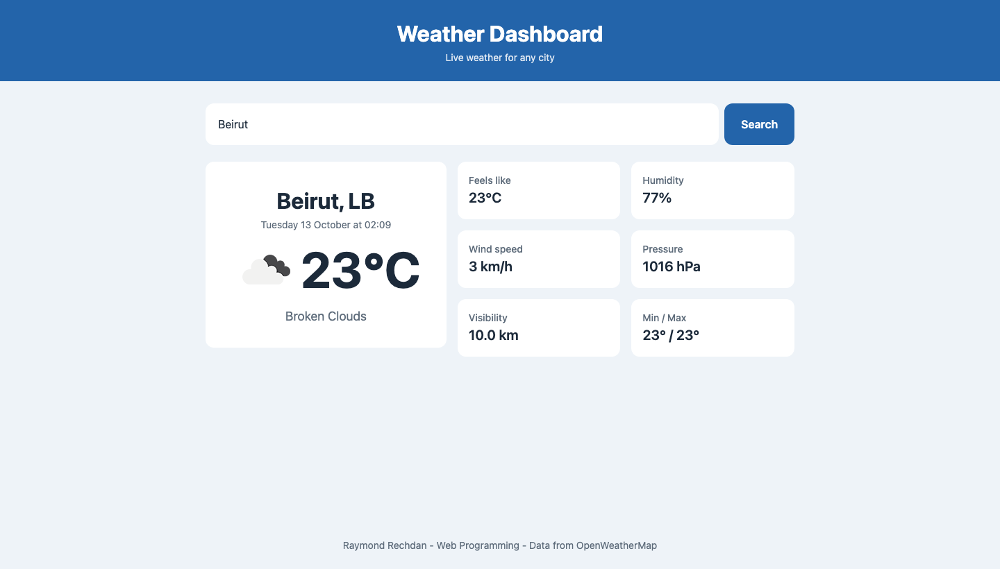

# Assignment 4 - Weather Dashboard

A weather dashboard that shows the current weather of any city, using live data from the **OpenWeatherMap** API.

Raymond Rechdan - Web Programming

## Setup (API key)

The API key is not in this repository. You need your own free key:

1. Create a free account at [openweathermap.org](https://home.openweathermap.org/users/sign_up).
2. Go to **API keys** in your account ([home.openweathermap.org/api_keys](https://home.openweathermap.org/api_keys)) and copy the default key. A new key can take up to an hour or two before it starts working.
3. In the `js` folder, copy `config.example.js` and name the copy `config.js`.
4. Open `js/config.js` and replace `YOUR_API_KEY_HERE` with your key:

```js
const API_KEY = "your key here";
```

`js/config.js` is listed in `.gitignore`, so the key is never committed to GitHub.

## How to open it

No build step. Open `index.html` in a browser, type a city and press **Search** (or Enter).

## Files

```
index.html             the page
css/styles.css         all the styles
js/app.js              fetch logic and rendering
js/config.example.js   placeholder for the API key (copy to config.js)
screenshots/           the page with weather data
```

## What it shows

- City name, country and the local time in that city
- Current temperature, description and the weather icon
- Feels like, humidity, wind speed, pressure, visibility and min/max temperature

## How the fetching works

- `getWeather(city)` in `js/app.js` is an `async` function that uses `await fetch(...)`.
- The `fetch` call is inside `try/catch`. If there is no connection at all, the user sees a message to check their internet.
- Non-200 responses are handled explicitly with `response.ok` and `response.status`:

| Status | Message shown |
|---|---|
| 404 | the city was not found |
| 401 | the API key is missing or not valid |
| 429 | too many requests, wait and try again |
| other | the weather service returned an error |

- An empty search and a missing API key are also caught before any request is sent.
- All the values on the page come from the API response. Nothing is hardcoded.

## Loading and error states

- While a request is running, a spinner with "Loading weather data..." is shown and the button is disabled ("Searching...").
- Errors are shown in a red box above the results, never only in the console.

## Responsive layout

Mobile-first, media queries use `min-width` only:

| Breakpoint | What changes |
|---|---|
| base | search input and button stacked, details in 2 columns |
| 600px | search input and button on one row, details in 3 columns |
| 1024px | main card and details side by side, bigger temperature |

Colors, spacing, font sizes, radius and transition speed are variables in `:root`.

## Screenshot


